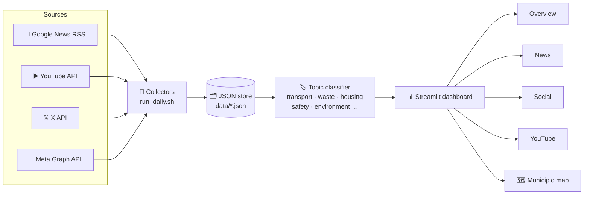

<!-- Rome City Intelligence · README -->
<div align="center">


<br/>


<br/><br/>

<a href="#-overview"><b>Overview</b></a> •
<a href="#-architecture"><b>Architecture</b></a> •
<a href="#-engineering-highlights"><b>Highlights</b></a> •
<a href="#-quick-start"><b>Quick Start</b></a> •
<a href="#-recruiter-snapshot"><b>Recruiter Snapshot</b></a> •
<a href="#-contact"><b>Contact</b></a>

</div>

---

# 🧭 Overview

A **civic-intelligence dashboard** that monitors publicly available news and online content about **Rome's transport, public services, safety and local government**. Collectors run on a daily schedule, records are **classified into civic topics**, and the dashboard lets you search, filter and explore issues across **Rome's 15 municipi** on an interactive map.

> 🚧 Under active development. Collection depends on each platform's API permissions and terms; counts are indicative, not a scientific poll.

---

# 🏗️ Architecture

<details open>
<summary><b>🧠 Collect → classify → explore (click to collapse)</b></summary>

<br/>



</details>


---

# ⚙️ Engineering Highlights

<details open>
<summary><b>🏁 What it does well (click to collapse)</b></summary>

<br/>

<table>
<tr>
<td width="25%" valign="top">

### 🧲 Multi-Source Ingestion
Independent collectors for RSS, YouTube, X and Meta — each optional and failure-isolated.

</td>
<td width="25%" valign="top">

### ⏱️ Scheduled Pipeline
`run_daily.sh` refreshes and classifies data automatically, with logging.

</td>
<td width="25%" valign="top">

### 🏷️ Civic Taxonomy
8 issue categories assigned via rules when sources lack labels.

</td>
<td width="25%" valign="top">

### 🗺️ Geo Exploration
GeoJSON boundaries of the 15 municipi rendered with Folium inside Streamlit.

</td>
</tr>
</table>

</details>


---

# 🚀 Quick Start

```bash
python -m venv .venv && source .venv/bin/activate
pip install -r requirements.txt
python collector.py && python classify_news.py
streamlit run app.py
```

---

# 🎯 Recruiter Snapshot

<details open>
<summary><b>📌 What to remember in 15 seconds (click to collapse)</b></summary>

<br/>

<table>
<tr>
<td width="50%" valign="top">

### ✅ Demonstrated
- Data collection from public APIs
- Text classification
- Geospatial visualisation
- Automated data pipeline

</td>
<td width="50%" valign="top">

### 🧠 Why it matters
- Turns scattered news into civic signals
- Responsible-data caveats built in
- Extensible to new sources

</td>
</tr>
</table>

</details>


---

# 📚 Full Technical Documentation

<details>
<summary><b>🛠️ Setup, configuration, API reference and implementation details (click to expand)</b></summary>

<br/>

A Streamlit dashboard for monitoring publicly available news and online content about Rome's civic services, mobility, local government, and related issues.

## Features

- Collects Italian Rome transport and mobility news from Google News RSS.
- Classifies news titles into civic issue topics.
- Optionally collects YouTube videos and recent X posts through their APIs.
- Stores collected news in `data/news.json`.
- Classifies records with keyword-based civic issue categories.
- Provides dashboard tabs for news, social discussion, and YouTube videos.
- Supports searching and filtering records by category and source.

## Requirements

- Python 3.10 or newer
- Internet access for RSS collection

## Installation

Create and activate a virtual environment, then install the dependencies:

```bash
python -m venv .venv
source .venv/bin/activate
pip install -r requirements.txt
```

On Windows PowerShell, activate the environment with:

```powershell
.venv\Scripts\Activate.ps1
```

## Usage

Collect the latest news:

```bash
python collector.py
python classify_news.py
```

Start the dashboard:

```bash
streamlit run app.py
```

The dashboard opens in your browser. Run the collector again whenever you want to refresh the news data, then use the dashboard's refresh button or reload the page.

Run the scheduled news pipeline:

```bash
./run_daily.sh
```

The script expects the project at `~/rome-intelligence` and uses the virtual environment at `.venv/`.

### Optional API collectors

Create a `.env` file in the project root for API-backed collectors:

```dotenv
YOUTUBE_API_KEY=your_youtube_api_key
X_BEARER_TOKEN=your_x_bearer_token
META_ACCESS_TOKEN=your_meta_access_token
META_APP_SECRET=your_meta_app_secret
META_GRAPH_API_VERSION=v22.0
META_PAGE_ID=your_facebook_page_id
INSTAGRAM_USER_ID=your_instagram_business_user_id
```

Then run either collector:

```bash
python youtube_collector.py
python x_collector.py
python meta_collector.py
```

The YouTube collector writes `data/youtube_posts.json`. The X collector writes `data/x_posts.json` and retrieves recent posts from the X API. Keep API keys and bearer tokens out of source control.

## Project Structure

```text
rome-intelligence/
├── app.py                # Streamlit dashboard
├── collector.py          # Google News RSS collector
├── classify_news.py      # Assigns topics to news records
├── youtube_collector.py  # Optional YouTube API collector
├── x_collector.py        # Optional X API collector
├── run_daily.sh          # News collection and classification pipeline
├── data/                 # JSON data files
├── requirements.txt      # Python dependencies
└── README.md             # Project documentation
```

## Data Sources

`collector.py` currently collects from this Google News RSS query:

- Rome transport and mobility news in Italian

The dashboard can also read these optional files when they are added to `data/`:

- `social_posts.json`
- `x_posts.json`
- `meta_posts.json`
- `youtube_posts.json`

If those files are missing, the corresponding dashboard sections remain empty. The X collector currently writes `x_posts.json`; the dashboard provides links for searching public X posts rather than loading that file as a dashboard dataset.

## Record Categories

News records may contain a `topic` or `category` field. When no category is supplied, the dashboard assigns one using keyword rules for:

- Public transport
- Waste management
- Housing
- City government
- Public services
- Environment
- Public safety
- Other

Keyword classification is approximate and should be manually verified before drawing conclusions. Collected article counts and online content do not represent a scientific poll or the views of Rome residents.

</details>


---

# 📬 Contact

<div align="center">

**Krishan Kumar** — AI Engineer & Data Scientist · Rome, Italy

<a href="https://www.linkedin.com/in/krishan-kumar-ml/"></a>
<a href="mailto:krishbijarniya@gmail.com"></a>
<a href="https://krishan-kumar-portfolio.vercel.app/"></a>
<a href="https://github.com/krishanbijarniya"></a>

</div>


